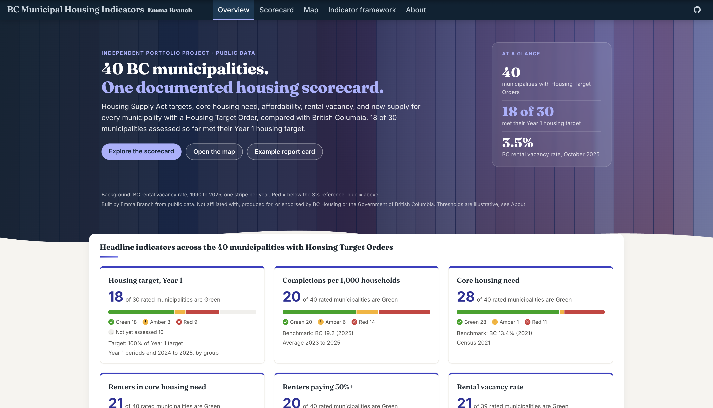

# BC Municipal Housing Indicators

A documented housing indicator framework and corporate-style performance scorecard for the 40 British Columbia municipalities with Housing Target Orders under the *Housing Supply Act*, with British Columbia as a benchmark. Built in R and Quarto from public data.

**Live dashboard:** https://emmabranch.github.io/bc-housing-indicators/ · **Example report card:** [Vancouver](https://emmabranch.github.io/bc-housing-indicators/reports/vancouver.html) · **More projects:** [github.com/emmabranch](https://github.com/emmabranch)



> **Independent portfolio project.** Not affiliated with, produced for, or endorsed by BC Housing or the Government of British Columbia. Red, amber, and green thresholds are illustrative choices documented in the indicator framework, not official standards.

## What it does

| Component | Where |
|---|---|
| Tidy indicator database (one row per geography, indicator, and year) | `data/indicators_long.csv` |
| Latest-value scorecard with red/amber/green status | `data/scorecard_latest.csv` |
| Indicator framework: definition, source, frequency, comparator, status rule, and limitations for each indicator | `data/indicator_framework.csv` |
| Data dictionary for every output file | `data/data_dictionary.csv` |
| Housing Supply Act targets and Year 1 results, with per-row source and verification status | `data/housing_targets.csv` |
| Data quality log | `qa/data_quality_log.md` |
| Quarto dashboard (overview, scorecard, map, framework, about) | `index.qmd`, rendered to `docs/` |
| Parameterised municipality report card (1 to 2 printable pages), rendered for all 40 municipalities | `reports/report_card.qmd`, rendered to `docs/reports/` |

## Indicators

**Headline KPIs (rated red, amber, or green)**

| ID | Indicator | Comparator |
|---|---|---|
| HTO_Y1 | Housing target progress: Year 1 net new units as % of Year 1 target | Target: 100% |
| COMPL_RATE | Housing completions per 1,000 households (3-year average) | Benchmark: BC rate |
| CHN_ALL | Households in core housing need | Benchmark: BC rate |
| CHN_RENT | Renter households in core housing need | Benchmark: BC rate |
| UNAFF_RENT | Renter households spending 30% or more of income on shelter | Benchmark: BC rate |
| VAC | Rental vacancy rate | Reference: 3% |

**Supporting indicators (shown, not rated):** average rent, average rent change (same units), and housing completions.

Full definitions, status rules, and limitations are in `data/indicator_framework.csv` and on the dashboard's *Indicator framework* page.

## Data and licences

- **Statistics Canada**, Census of Population 2016 and 2021, Table 98-10-0259-01, *Housing indicators by tenure*, via the `cansim` R package. Statistics Canada Open Licence.
- **CMHC Housing Market Information Portal**: Rental Market Survey and Starts and Completions Survey, via the `cmhc` R package. *Adapted from Canada Mortgage and Housing Corporation, Housing Market Information Portal, accessed November 2026. This information is reproduced and distributed on an "as is" basis with the permission of CMHC.*
- **Housing Supply Act targets and Year 1 results**: BC Government news releases and municipal progress reports (primary), and the Storeys housing targets tracker (secondary). No machine-readable source exists, so these were compiled by hand; see below.
- **Boundaries**: Statistics Canada, 2021 Census cartographic boundary files (census subdivisions). Basemap: Esri World Gray Canvas.

## Data quality and validation

The full log is in `qa/data_quality_log.md`. Main points:

- **Geography codes verified, not assumed.** All joins use Statistics Canada census subdivision codes, because names are not unique (for example, the City and Township of Langley). An automated name check caught 6 of 40 initially incorrect codes; all 40 were then verified against census names, household counts, and boundary-file municipality types.
- **Output validated against published figures.** The pipeline reproduces Statistics Canada's published BC core housing need rates exactly: 14.9% (2016) and 13.4% (2021) for all households; 29.9% and 24.7% for renters.
- **Suppressed and missing values are shown, not imputed.** Census cells marked "x" and CMHC values suppressed for reliability are left missing. Where a municipality's latest CMHC value is older than the most recent survey year, the scorecard flags it (†). Average rent change is too often suppressed to rate, so it is a supporting indicator only.
- **Housing target values are traceable.** Each row of `data/housing_targets.csv` records its source URL and whether it was checked against a primary source. 14 of 30 Year 1 results are verified against BC Government releases or municipal progress reports, including a spot check of three Group 2 values against the municipal PDFs (all matched). A secondary source disagreed with official figures for some interim six-month results, so only full Year 1 results are used.
- **Benchmarks are labelled honestly.** The 3% vacancy rate is an industry rule of thumb that CMHC's 2026 mid-year rental market update says does not hold across all markets; it is used as a reference, not a target.

## How to reproduce

Requires R (4.1 or later) and Quarto. Packages: `tidyverse`, `here`, `cansim`, `cmhc`, `sf`, `leaflet`, `reactable`, `htmltools`, `quarto`.

```r
source("R/00_run_all.R")   # downloads data, rebuilds data/, renders docs/
```

Or run the scripts in order:

1. `R/01_municipalities.R`: municipality lookup
2. `R/02_get_census.R`: Statistics Canada census data and code verification
3. `R/03_get_cmhc.R`: CMHC rental and completions data
4. `R/04_housing_targets.R`: hand-compiled Housing Supply Act targets and results
5. `R/05_build_indicators.R`: indicator database, scorecard, framework, data dictionary
6. `R/06_boundaries.R`: municipal boundaries
7. `R/07_render_report_cards.R`: renders the report card for each municipality into `docs/reports/`
8. `quarto render`: builds the dashboard into `docs/`

To render a single report card, run in a terminal from the project root: `quarto render reports/report_card.qmd -P geo_uid:5915022` (any census subdivision code from `data/municipalities.csv`).

Raw downloads are cached in `data-raw/`, which is not committed.

## Limitations

- Census indicators are from 2021, the latest available. Incomes in 2020 included temporary pandemic benefits, which likely lowered measured need.
- Census subdivision values should not be compared with published census metropolitan area (CMA) figures.
- Housing target Year 1 periods differ by group (ending 2024 or 2025), and Group 4 results had not been published at the time of compilation.
- CMHC completions are gross; Housing Supply Act net new units subtract demolitions, so the two do not match.
- CMHC rental data cover purpose-built rentals only.

## About me

I am new to housing data; this project was a way to learn the main public sources and indicators and to show how I approach indicator definition, data quality, and performance reporting. Corrections are welcome via GitHub issues.

I'm Emma Branch, an epidemiologist and data analyst in British Columbia, and a PhD candidate in Population and Public Health at the University of British Columbia. I've spent about 10 years working with health research data, including registry analytics, REDCap database design, data governance, and performance measurement. I mostly work in R, SAS, and SQL, and build reports and tools with Quarto, Shiny, leaflet, and Power BI. Lately I've been applying the same habits to environmental and ocean data, mostly because I like maps and fish.

[More projects](https://github.com/emmabranch) · [LinkedIn](https://www.linkedin.com/in/embranch/) · emma.branch@gmail.com
